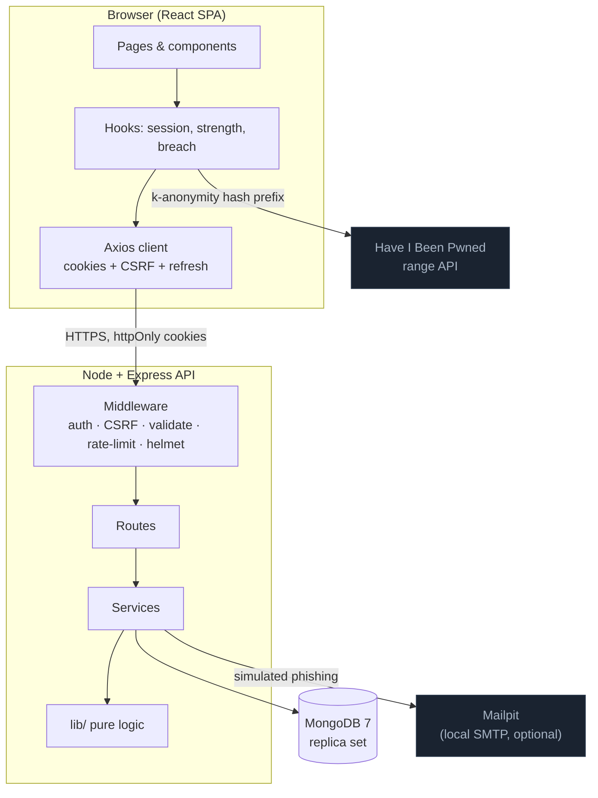
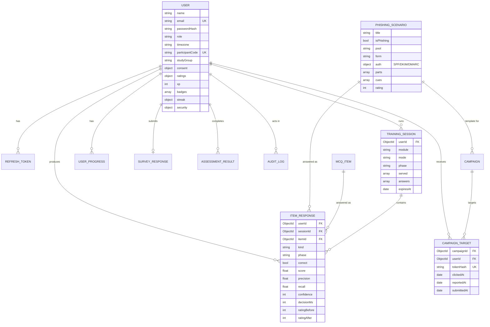
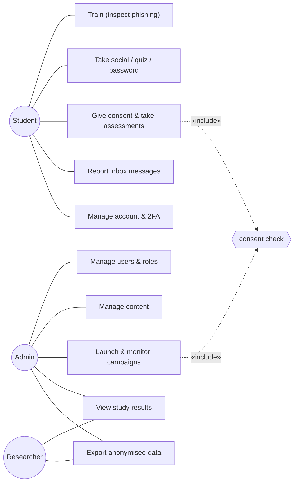
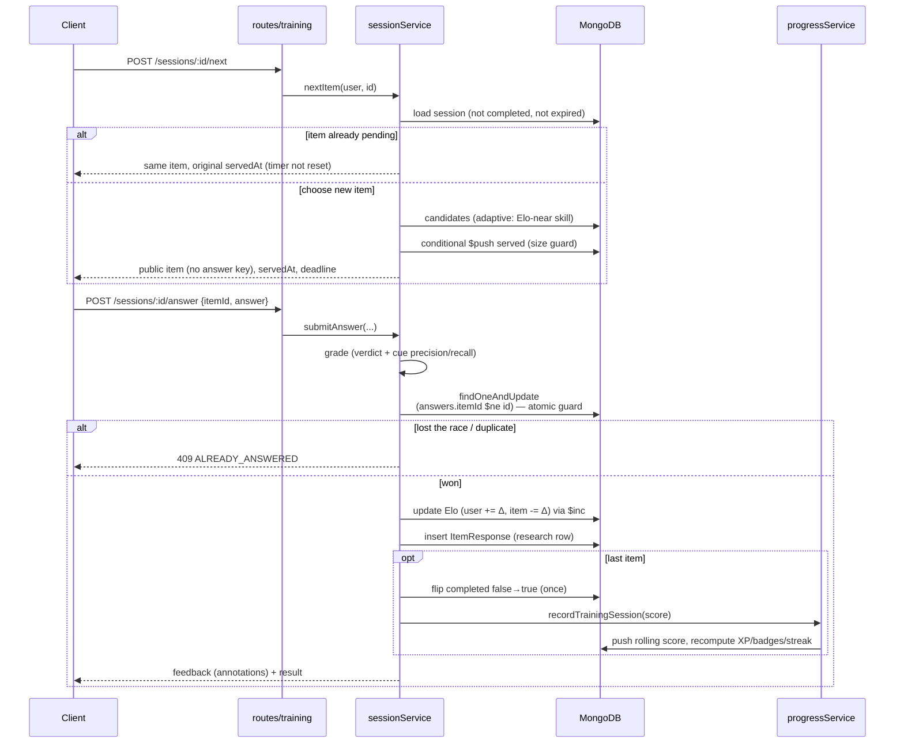

# Architecture — CSAS

This document describes the system structure and includes the UML diagrams an examiner expects: a component/deployment view, an entity-relationship diagram, a use-case diagram, and a sequence diagram of the core answer flow.

---

## 1. Architectural style

A three-tier web application with a **thin client** and a **server that owns all truth**. The React client renders state and collects input; it never grades answers, computes scores, or holds answer keys. This is a deliberate choice for a security-subject project: anything the client is trusted to compute, an attacker can forge (this was the central flaw in the earlier version, where the browser sent its own password score).

Logic is layered on the server so that the interesting parts are pure and testable:

```text
routes/      HTTP: parse (Zod), authorise, call a service, shape the response
services/    Orchestration: sessions, campaigns, progress, analytics, tokens
lib/         Pure functions: elo, stats, cueScoring, gamification, totp, crypto, time
models/      Mongoose schemas (persistence)
```

The `lib/` layer has no database or HTTP dependency, so it is unit-tested in isolation; the `services/` and `routes/` layers are covered by HTTP integration tests against a real MongoDB.

---

## 2. Component & deployment view



**Deployment.** In production a single Node process serves both the API and the built client (`SERVE_CLIENT=true`), so the app is one origin and the auth cookies can be `SameSite=Strict`. Docker Compose adds MongoDB (replica set) and Mailpit. The client can alternatively be served by nginx/CDN with the API proxied.

---

## 3. Request pipeline

Every `/api` request passes through this chain before reaching a handler:

```text
requestLog → helmet(CSP) → permissionsPolicy → json body limit → cookieParser
  → noStore → csrfProtection → rateLimit → [route] requireAuth → requireRole
  → validate(Zod) → controller → service → lib
  → errorHandler (central, typed)
```

Validation replaces `req.body`/`req.params` with the parsed, typed, unknown-key-stripped result, so a controller never sees an unexpected field.

---

## 4. Entity-relationship diagram



`ITEM_RESPONSE` is deliberately the hub: it is both the gameplay record and the research dataset.

---

## 5. Use-case diagram



(The researcher role is an admin acting in a research capacity; the system has two roles, student and admin.)

---

## 6. Sequence diagram — answering a phishing item

This is the core flow and the one most worth understanding, because it is where concurrency, scoring, adaptivity, and the research record all meet.



### Why the atomic guard matters
Two parallel submissions for the same item (double-click, retried request) could both pass a naive "already answered?" check and both record a response, double-counting XP. The write is instead a single `findOneAndUpdate` with the condition `'answers.itemId': { $ne: itemId }`, so only one can succeed; the other gets a 409. This is covered by the integration test *"concurrent duplicate answers: exactly one succeeds"*.

---

## 7. Key design decisions

| Decision | Rationale | Alternative rejected |
|---|---|---|
| Server owns all grading | A security app cannot trust the client; forging a score must be impossible | Client-side scoring (the earlier version's flaw) |
| httpOnly cookies + refresh rotation | An XSS cannot read the token; reuse detection catches stolen refresh tokens | localStorage JWT (readable by any script) |
| Elo for adaptivity | Achievable, explainable, needs no training data, updates online | Item Response Theory (needs calibration data and heavier statistics) |
| Rolling-average module score | A lucky session cannot lock in a high score; the score tracks current skill | Best-ever score (gameable by replay) |
| Derived gamification | XP/badges recomputed from responses can never drift from reality | Incrementing stored counters (the earlier version showed 200 XP with 0 attempts) |
| k-anonymity breach check | Checks real breaches without the password or full hash leaving the device | Sending the password to a server (unacceptable in a security tool) |
| One `ItemResponse` per answer | Single source for both gameplay and research analytics | Separate ad-hoc aggregates (drift, duplication) |

---

## 8. Technology rationale (short)
MongoDB suits the heterogeneous content (emails with parts and cues, MCQs with transcripts) and the append-heavy response log; the replica set gives transactions and TTL indexes. Express keeps the HTTP surface small and explicit. React with Vite gives a fast build and natural component decomposition for the inspector and runners. Zod gives a single place where the shape of every request is defined and enforced.
