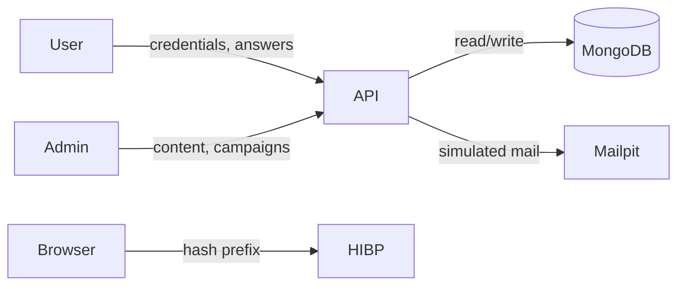

# Threat Model — CSAS

A security-awareness application must itself be secure, so this threat model is a first-class deliverable, not an appendix. It uses **STRIDE** over the system's main assets and trust boundaries, states the mitigation in place, and points to where it lives in the code and how it is verified.

---

## 1. Assets
- **User credentials** (passwords, TOTP secrets, session tokens).
- **Research data** (item responses, assessment results) — must stay anonymous and intact.
- **Integrity of scores** (XP, awareness score, campaign metrics) — the output of the whole system.
- **Admin capability** (content, campaigns, data export).

## 2. Trust boundaries
1. Browser ↔ API (the network; the client is untrusted).
2. API ↔ MongoDB.
3. API ↔ external services (HIBP from the browser; SMTP/Mailpit from the server).
4. Student ↔ Admin privilege boundary within the API.

## 3. Data-flow (simplified)

---

## 4. STRIDE analysis

### S — Spoofing (pretending to be someone else)
| Threat | Mitigation | Where | Verified |
|---|---|---|---|
| Forging a session to act as another user | JWT access tokens signed HS256, verified with audience/issuer; identity taken from the token, never from the request body | `services/tokenService.js`, `middleware/auth.js` | integration |
| Stealing a token via XSS | Tokens are httpOnly cookies, unreadable by JavaScript; strict CSP blocks injected scripts | `tokenService.js`, `middleware/security.js` | inspection |
| Reusing a stolen refresh token | Refresh tokens rotate on every use; replay of a rotated token revokes the whole family | `rotateRefreshToken` | unit/integration |
| Brute-forcing a password | Account locks for 15 min after 5 failures; auth endpoints rate-limited; constant-time dummy hash hides unknown emails | `routes/auth.js` | integration |
| Impersonating the server to a user | HSTS in production; single-origin cookies `SameSite=Strict` | `security.js`, `tokenService.js` | inspection |

### T — Tampering (unauthorised modification)
| Threat | Mitigation | Where | Verified |
|---|---|---|---|
| Forging an answer score (the earlier version's flaw) | All grading is server-side; the client never sends a score, only a choice; answer keys never leave the server | `modules/`, `sessionService.js` | integration (*"score computed by the server"*) |
| Injecting unexpected fields into a request | Zod parses and strips every body/param; unknown keys are dropped | `middleware/validate.js` | integration |
| Tampering with an encrypted secret (TOTP) at rest | AES-256-GCM (authenticated encryption); tampered ciphertext fails to decrypt | `lib/crypto.js` | unit |
| Double-counting via concurrent/duplicate answers | Atomic conditional write (`answers.itemId $ne`); only one succeeds | `sessionService.js` | integration (concurrency test) |
| CSRF-forcing a state change from another site | Double-submit CSRF token required on all mutating requests; `SameSite=Strict` cookies | `middleware/csrf.js` | integration |
| NoSQL operator injection | Inputs are typed primitives via Zod before reaching a query; no raw user objects passed to Mongo operators | `validate.js`, routes | inspection |

### R — Repudiation (denying an action)
| Threat | Mitigation | Where |
|---|---|---|
| An admin denies launching a campaign or exporting data | Append-only audit log records actor, action, target, IP, outcome for auth and admin actions | `services/auditService.js`, `models/AuditLog.js` |
| A user denies an action | Every item response is stored with timestamps; sessions record served/answered times | `models/ItemResponse.js` |

### I — Information disclosure
| Threat | Mitigation | Where | Verified |
|---|---|---|---|
| Leaking answer keys to the client | Public item views omit `isPhishing`, cues, and correct index | `modules/phishing.js`, `modules/mcq.js` | integration (*"never leaks the answer key"*) |
| Leaking a user's password to any server | Password analysis runs in the browser; breach check sends only a 5-char hash prefix (k-anonymity) | `hooks/usePwnedCheck.js` | inspection |
| Capturing credentials on the simulated landing page | The landing form discards field values; the submit call sends an empty body | `routes/campaignPublic.js`, `pages/Landing.jsx` | integration |
| Enumerating registered emails by timing | Login compares against a constant dummy hash when the email is unknown | `routes/auth.js` | inspection |
| Exposing participant identities in research data | Data stored and exported under anonymous participant codes | `analyticsService.js` | integration (CSV header) |
| Secrets/tokens in logs | Pino redacts cookies, auth headers, passwords, codes; tracking tokens masked in request logs | `lib/logger.js`, `middleware/requestLog.js` | inspection |
| Clickjacking | `frame-ancestors 'none'` (CSP) and `X-Frame-Options` via Helmet | `security.js` | inspection |

### D — Denial of service
| Threat | Mitigation | Where |
|---|---|---|
| Flooding endpoints | Persistent (MongoDB-backed) fixed-window rate limiting, surviving restarts and shared across instances; stricter limits on auth | `middleware/rateLimit.js` |
| Oversized request bodies | JSON body limited to 100 kB; 413 returned beyond it | `app.js`, `errorHandler` |
| Unbounded session/token growth | TTL indexes expire training sessions, refresh tokens, and rate-limit windows automatically | model indexes |
| Expensive password hashing abused | Login is rate-limited and lockout-guarded; bcrypt cost tuned (4 in tests, 12 in prod) | `routes/auth.js` |

### E — Elevation of privilege
| Threat | Mitigation | Where | Verified |
|---|---|---|---|
| A student calling admin endpoints | `requireRole('admin')` on every admin route; checked, not assumed from the client | `middleware/auth.js`, `routes/admin.js` | integration (*"student cannot reach admin"*) |
| A user acting inside another user's session | Every session/response query is scoped to `userId`; cross-user access returns 404/400 | `sessionService.js` | integration (object-level authz test) |
| A stale token keeping old privileges after a role change | Role changes bump `tokenVersion`, invalidating existing access tokens | `requireAuth`, `routes/admin.js` | integration |
| Targeting non-consenting users with a campaign | Consent filtered server-side before any target is created | `campaignService.js` | integration |
| An admin demoting themselves into lockout | Self-role-change is rejected | `routes/admin.js` | integration |

---

## 5. Residual risks & future work
- **Key management.** Secrets live in environment variables, appropriate for a capstone deployment but not a secrets manager/HSM. Production would use a managed KMS and envelope encryption.
- **TOTP recovery codes.** Not implemented; a locked-out 2FA user needs admin reset. Recovery codes are a natural next step.
- **Email authenticity of real campaigns.** Campaign emails are simulated and local (Mailpit). Sending to real inboxes would need SPF/DKIM alignment and, crucially, ethics approval.
- **Dependency risk.** Mitigated by `npm audit` and CodeQL in CI, but not eliminated.

---

## 6. Verification summary
Security requirements are backed by automated tests wherever behaviour (not just configuration) can be exercised: answer-key non-leakage, server-side scoring, concurrency safety, account lockout, refresh-token reuse, CSRF rejection, role and object-level authorisation, token invalidation on role change, and consent enforcement. Configuration-level controls (CSP, HSTS, redaction) are verified by inspection and by header assertions in the integration suite.
