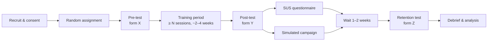

# User-Study Protocol — CSAS

This is the HCI pillar's backbone: a pre-registered-style protocol for the controlled study the platform runs. Treat it as a template to adapt to your institution's ethics requirements — it is written to be defensible in a viva, not to replace ethics approval.

---

## 1. Research questions & hypotheses

**RQ1.** Does adaptive, gamified, behaviour-based training improve phishing-detection accuracy more than static, non-gamified training?

- **H1 (primary):** The adaptive group shows a greater pre→post improvement in mean assessment score than the control group.
- **H0:** No difference in improvement between groups.

**RQ2.** Does any improvement persist after 1–2 weeks (retention)?

- **H2:** The adaptive group retains more of its gain at the retention test than the control group.

**RQ3 (secondary).** Does training reduce the simulated-phishing **click rate** and increase the **report rate**?

**RQ4 (secondary).** How do the two conditions compare on usability (SUS) and on **confidence calibration** (over/under-confidence)?

---

## 2. Design

A **between-subjects, randomised controlled design** with repeated measures (pre, post, retention).

| Factor | Levels |
|---|---|
| Group (between) | Adaptive (gamified, Elo-adaptive) · Control (static, non-gamified) |
| Phase (within) | Pre-test · Post-test · Retention test |

Assignment is automatic and balanced: each new consenting participant joins whichever group is currently smaller (ties broken randomly). This is implemented in `routes/study.js` (`assignGroup`).

### Why a control group
Without a comparison condition, any pre→post gain could be explained by practice, test familiarity, or regression to the mean. The control group receives the *same content and the same amount of practice*, differing only in adaptivity and gamification, so a between-group difference isolates the effect of those two factors.

---

## 3. Participants
- **Target N:** ~30 (about 15 per group) as a feasible minimum for a student project; more improves power.
- **Population:** university students (the content is tuned to the Indian student context).
- **Inclusion:** adult students who consent.
- **Exclusion:** none beyond non-consent.

A formal power analysis should be run in G*Power; as a rough guide, detecting a medium effect (d ≈ 0.6) between two groups at α = .05 with 80% power needs ~45 per group, so a 30-participant study is explicitly **exploratory** and should be reported as such.

---

## 4. Materials

### Assessment instrument
Three **parallel forms** (A, B, C), each with 6 emails (4 phishing across easy/medium/hard, 2 legitimate), matched in structure so the forms are comparable (`seed/content/phishingAssessment.js`). Forms are **counterbalanced** per participant by rotating the form order from the participant code (`formFor` in `sessionService.js`), so no single form is always the pre-test. Assessments show **no feedback**, do not appear in training, and record verdict, cue precision/recall, confidence, and decision time.

### Training
Adaptive group: Elo-adaptive item selection targeting ~70% success, with XP/badges/streaks. Control group: fixed curriculum order, least-seen-first, no gamification. Both draw from the same 24 training emails plus social/quiz/password modules.

### Simulated campaign
A consented simulated-phishing email with click/report tracking, including one legitimate "control" template to measure false reporting.

### Questionnaire
System Usability Scale (10 items, standard scoring, `lib/stats.js::susScore`).

---

## 5. Procedure

The system enforces the gating: the post-test unlocks only after the pre-test and a minimum number of training sessions (`POST_TEST_MIN_SESSIONS`), and the retention test opens only after a configured delay (`RETENTION_DAYS`).

---

## 6. Measures (dependent variables)

| Measure | Definition | Source |
|---|---|---|
| **Detection accuracy** (primary) | Proportion of assessment items with a correct verdict | `AssessmentResult.accuracy` / `meanScore` |
| Phish detection rate | Correct verdicts on phishing items only | `phishDetectionRate` |
| False-positive rate | Legitimate emails wrongly called phishing | `falsePositiveRate` |
| Cue recall | Fraction of true red flags flagged | `meanRecall` |
| Decision time | Milliseconds from item served to answered | `meanDecisionMs` |
| Confidence calibration | Brier score and over/under-confidence | `brier`, `lib/stats.js` |
| Click / report rate | From the simulated campaign | `campaignService.js` |
| Usability | SUS score (0–100) | `SurveyResponse` |

Measuring **both** detection and false positives matters: a participant who flags everything as phishing is not safe, just noisy. Over-suspicion is a real, documented problem and is tracked explicitly.

---

## 7. Analysis plan

1. **Primary (H1):** Welch's t-test comparing pre→post *gain* between groups; report t, df, p, and Cohen's d. Implemented and displayed in the admin study dashboard; **confirm in R/SPSS** from the CSV export before reporting.
2. **Within-group:** paired t-tests pre→post for each group (`pairedTTest`).
3. **Retention (H2):** between-group comparison of pre→retention retained gain.
4. **Secondary:** compare click/report rates, SUS, and calibration between groups.
5. **Assumptions:** check normality (Shapiro–Wilk) and consider non-parametric alternatives (Mann–Whitney, Wilcoxon) if violated — the built-in t-tests are a first look, not the final word.

The platform's statistics are textbook implementations (Welch, paired t, incomplete-beta p-values) and are unit-tested against known values, but the report must cross-check them in established software. The CSV export exists for exactly this.

---

## 8. Ethics & data protection
- **Informed consent** before any data collection; participation voluntary; withdrawal at any time (the system supports consent withdrawal).
- **Anonymity:** data stored and exported under participant codes, never names.
- **No sensitive capture:** real passwords stay in the browser; the simulated landing page records only that a submission occurred.
- **Debrief:** participants are told which emails were simulated and why, and given the teachable-moment lessons.
- **Approval:** obtain written ethics-committee approval before running the simulated campaign on real people. This is the longest-lead item; start it first.

---

## 9. Threats to validity
- **Internal:** test familiarity (mitigated by parallel counterbalanced forms); differential attrition between groups (report dropout per group).
- **External:** a single-institution student sample limits generalisation.
- **Construct:** assessment emails are a proxy for real-world behaviour; the simulated campaign is included precisely to add a behavioural, not just a judgement, measure.
- **Statistical:** an exploratory N; report effect sizes and confidence intervals, not just p-values, and avoid over-claiming.
